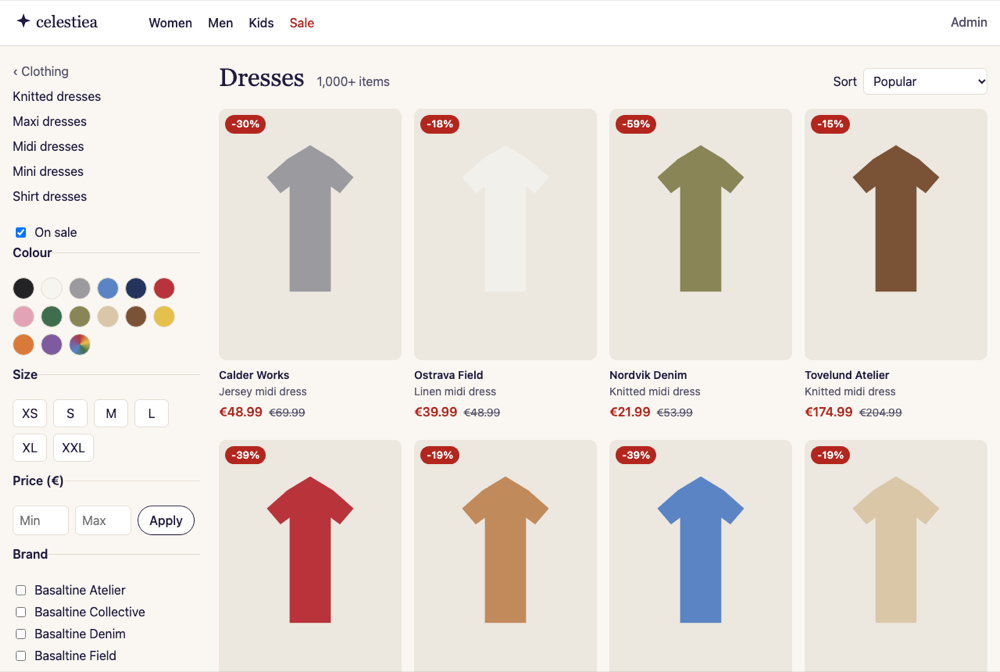
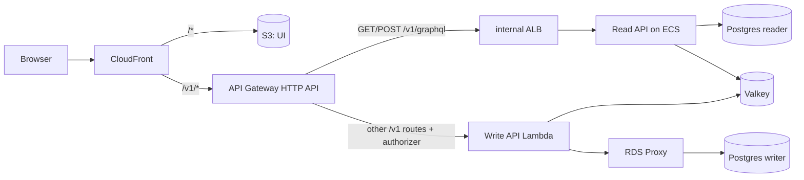
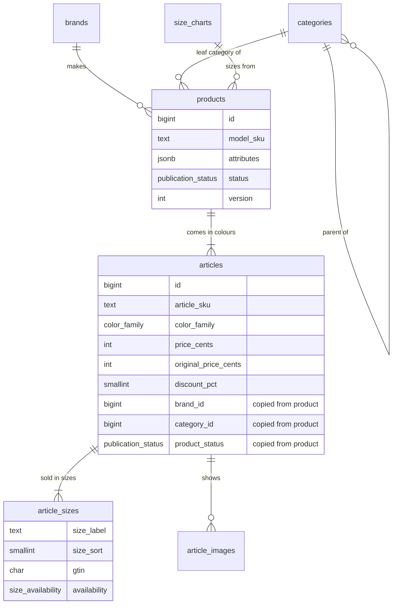

# celestiea

A product catalog for a fashion shop: a GraphQL read API on ECS, a REST write API on
Lambda, PostgreSQL, and a React storefront with an admin page, all provisioned on AWS with
Terraform. Built as a take-home assignment; brands and products are generated and
fictional.

**Live URL:** _not deployed yet (filled in after the first `make deploy ENV=dev`)_



## Quick start (local)

Needs Docker, Node 22+ and pnpm (`corepack enable`). Ports 5432, 6379 and 8080 must be free.

```sh
cd app && pnpm install && cd ..
make local                    # postgres, valkey, migrate, read-api, write-api, web, gateway
make seed-local               # full catalog: 303k articles, 1.7M sizes, about a minute
make seed-local SCALE=small   # or about 5k articles in seconds
```

Open http://localhost:8080 for the shop and http://localhost:8080/v1/graphiql for GraphiQL.

```sh
# A listing: sale dresses between €30 and €80, cheapest first
curl -sG localhost:8080/v1/graphql --data-urlencode 'query={
  articles(filter: {category: "women-clothing-dresses", onSale: true, minPriceCents: 3000, maxPriceCents: 8000},
           sort: price_asc, first: 3) {
    nodes { sku productName price { currentCents originalCents discountPct } availableSizes }
    pageInfo { endCursor hasNextPage }
    totalCount { value isCapped }
  }
}'

# A write (token from app/.env.example): put an article on sale
curl -s -X PATCH localhost:8080/v1/articles/<SKU> \
  -H 'authorization: Bearer local-dev-token' -H 'content-type: application/json' \
  -d '{"priceCents": 2999, "originalPriceCents": 4999}'
```

`make test` runs the unit and integration tests against the compose Postgres and Valkey;
`make lint` runs ESLint, Prettier and the type checker.

## Deploy to AWS

Prerequisites: AWS credentials for the account, Terraform ≥ 1.11, Docker with buildx, jq.

```sh
make bootstrap                                   # once: state bucket and ECR repositories
make deploy ENV=dev ALERT_EMAIL=you@example.com  # build, push, apply, migrate, publish UI, smoke test
make seed ENV=dev                                # generate locally, upload to S3, import inside the VPC
```

Write routes need the admin token, which Terraform generates and never stores in state:

```sh
aws secretsmanager get-secret-value --query SecretString --output text \
  --secret-id "$(terraform -chdir=infra/terraform/envs/dev output -raw admin_token_secret_arn)"
```

**Tear down with `make destroy ENV=dev`.** Dev is sized for the free tier (about $1.30 a
month on the legacy free tier, about $55 without it); prod is about $365 a month at idle
([cost](docs/cost.md)). In dev a $100 budget triggers a kill switch that stops the
environment; `make resume ENV=dev` brings it back.

CI (`.github/workflows/ci.yml`) needs no AWS access: it lints, type-checks, tests and
builds the app and images, and runs Terraform fmt, tflint, validate and the module tests.
Deploys run from a laptop with `make deploy`. Deploying from CI would need a GitHub OIDC
provider and role in the account; this account's organization policy denies creating
OIDC providers, so that part was removed rather than replaced with long-lived keys.

## Architecture



A read is a cacheable `GET /v1/graphql` that CloudFront serves from the edge for 30 to 60
seconds; on a miss it goes through API Gateway and the VPC link to the read API, which
reads Valkey (product detail) and the Aurora reader. A write is a REST call through the
authorizer to the Lambda, which commits on the writer through RDS Proxy, overwrites the
product in Valkey and returns the updated product. Sequence diagrams for both, the local
stack and the network rules are in [docs/architecture.md](docs/architecture.md).

The free-tier dev environment keeps this shape but uses one RDS instance (no reader, no
proxy), one t3.micro ECS host and no Valkey ([ADR 0007](docs/adr/0007-terraform-and-repo-separation.md)).

## Data model



A **product** is a style ("Relaxed fit denim jacket"). Each **article** is one colour of it,
with its own price, sale and images. Articles are the unit a shopper sees as a tile, so
filtering, sorting and pricing all happen on them. **Sizes** are the purchasable SKUs,
ordered by the size chart (S < M < L), each with a GTIN and availability. Product fields that listings
filter on are copied onto articles in the same transaction, so one index on `articles`
serves each listing ([ADR 0003](docs/adr/0003-product-article-size-model.md)).

Categories are an `ltree` tree (`women.clothing.dresses.maxi`); a parent category filter
expands to its leaves. Prices are integer cents. Attributes are JSONB and deliberately not
indexed.

### Indexes

All listing indexes on `articles` are partial on "not deleted, article active, product
active", so they contain only rows a shopper can see.

| Index                                                                                  | Serves                                                                 |
| -------------------------------------------------------------------------------------- | ---------------------------------------------------------------------- |
| `(category_id, popularity_score DESC, id DESC)`                                        | default listing of a leaf category                                     |
| `(category_id, price_cents, id)`                                                       | category + price range, price sorts (scanned backwards for descending) |
| `(category_id, released_at DESC, id DESC)`                                             | "new in" within a category                                             |
| `(popularity_score DESC, id DESC)`, `(price_cents, id)`, `(released_at DESC, id DESC)` | listings without a category, and parent categories                     |
| `(discount_pct DESC, id DESC) WHERE is_on_sale`                                        | "biggest discount"                                                     |
| `(brand_id, category_id)`                                                              | brand filters                                                          |
| `(product_id)`, `UNIQUE (article_sku)`                                                 | product detail, SKU lookup                                             |
| `article_sizes (article_id, size_label)` unique                                        | sizes of an article                                                    |
| `article_sizes (size_label, article_id) WHERE availability <> 'out_of_stock'`          | size filter                                                            |
| `categories USING gist (path)`                                                         | descendant lookup                                                      |

Every sort index ends in `id` in the same direction, so the keyset condition
`(sort_key, id) > (…)` is one index range. Real plans for each listing, all around 1 ms on
the full seed: [docs/query-plans.md](docs/query-plans.md).

## Key decisions

- [0001 Build vs. buy](docs/adr/0001-build-vs-buy.md): in production, evaluate SaaS or an open-source engine first; this repo builds because the assignment asks.
- [0002 PostgreSQL / Aurora](docs/adr/0002-postgres-aurora-as-primary-store.md): composite partial indexes fit "filter, sort, page"; JSONB for attributes; facets need a search engine.
- [0003 Product → article → size](docs/adr/0003-product-article-size-model.md): colour article as the listing unit; fields copied from the product in the same transaction; aggregate version.
- [0004 Read/write split](docs/adr/0004-read-write-split.md): ECS for steady reads, one Lambda for bursty writes, API Gateway routing, RDS Proxy, replica lag.
- [0005 Keyset pagination](docs/adr/0005-keyset-pagination.md): stable under concurrent writes; page 41 costs 1 ms, `OFFSET` 18 to 141 ms.
- [0006 Caching](docs/adr/0006-caching-strategy.md): CloudFront for 30 to 60 s with no invalidation per write, Valkey with write-through, reference data in memory.
- [0007 Terraform and environments](docs/adr/0007-terraform-and-repo-separation.md): app and infra separated, write-only secrets, prod vs. free-tier dev.
- [0008 GraphQL reads, REST writes](docs/adr/0008-graphql-reads-rest-writes.md): cacheable GET queries; HTTP semantics for writes; one problem shape.
- [0009 Cross-region plan](docs/adr/0009-cross-region.md): Aurora Global Database, per-region read APIs, a single write region.

API contracts: [docs/schema.graphql](docs/schema.graphql) (reads) and
[docs/openapi.yaml](docs/openapi.yaml) (writes), both generated with `pnpm docs:api`.

## Scaling path (described, not built)

1. More Aurora readers and more read tasks; the read API is stateless apart from a
   5-minute memo of reference data.
2. Longer CloudFront lifetimes with `stale-while-revalidate` and origin shield; trusted
   documents (persisted queries) so only known GraphQL queries run.
3. When attribute filters, facet counts on any filter combination, full-text search, typo
   tolerance or personalization are needed: project articles into **OpenSearch or
   Typesense** through a **transactional outbox → EventBridge or SQS → indexer Lambda** (or
   CDC from the WAL). Postgres stays the source of truth and keeps serving product detail
   and writes.
4. International traffic: Aurora Global Database with read APIs per region
   ([ADR 0009](docs/adr/0009-cross-region.md)).
5. Partitioning `articles` and `article_sizes` only at orders of magnitude more data; at
   300k articles every listing is an index range.

## Benchmarks

Local compose stack, full seed, k6 on the same 2017 laptop ([details](docs/benchmarks.md)):

| Scenario                    | p50     | p95      |
| --------------------------- | ------- | -------- |
| Filtered listing            | 31.7 ms | 63.6 ms  |
| 20 consecutive cursor pages | 16.4 ms | 29.1 ms  |
| Product detail, Valkey miss | 34.8 ms | 104.6 ms |
| Product detail, Valkey hit  | 10.2 ms | 29.3 ms  |
| Price update (write)        | 25.1 ms | 59.4 ms  |

The database part of a listing is about 1 ms; most of the rest is the laptop running
Docker, the gateway and the load generator together. No AWS numbers yet.

## Known limitations and next steps

- **Auth**: one shared bearer token for writes. Next: Cognito or OIDC with an API Gateway
  JWT authorizer, and per-user audit fields.
- **Not deployed yet**, so the AWS configuration has passed `validate`, `tflint` and
  plan-time tests but has never been applied. Expect fixes on the first apply.
- **Single currency and locale**: EUR only, English content. Per-country prices and
  translated content would need price lists and content tables keyed by market.
- **No inventory** beyond size availability flags; no reservations, carts or checkout.
- **No search engine**, so no attribute facets, relevance ranking or typo tolerance
  ([scaling path](#scaling-path-described-not-built)).
- **No audit log** of catalog changes, and no outbox yet (needed for search and
  cross-region cache updates).
- **Deploys**: ECS rolling updates with a circuit breaker; no blue/green, and dev has a
  short gap per deploy. The prod deploy role has administrator rights and should be
  narrowed to the services used.
- **UI** has no component tests; behaviour is tested at the API level. The size filter
  picks size systems from the category path.
- **Not tested**: the Terraform against real AWS, the kill switch end to end, and the S3
  seed import (`aws_s3` exists only on RDS/Aurora, not in the local Postgres).

## AI usage

I built this with an AI coding assistant (Claude Code) doing most of the typing. I set
the requirements and constraints, made or approved the design decisions recorded in the
ADRs, reviewed the code and own the result.
