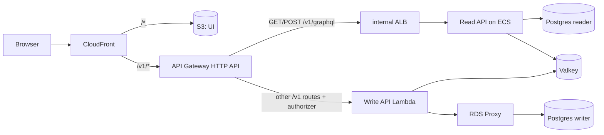

# celestiea

A product catalog for a fashion shop: a GraphQL read API on ECS, a REST write API on
Lambda, PostgreSQL, and a React storefront with an admin page, all provisioned on AWS with
Terraform. Built as a take-home assignment; brands and products are generated and
fictional.

**Live URL (dev, free-tier sized):** https://d355y0in4rw4ow.cloudfront.net, seeded with the
small catalog (about 5k articles).


## Quick start

Needs Docker, Node 22 or 24 with pnpm 10, git and make; `make doctor` checks them.

```sh
cd app && pnpm install && cd ..
make local                    # the whole stack on http://localhost:8080
make seed-local SCALE=small   # about 5k articles; omit SCALE for the full 303k
make test
```

More commands and example requests: [local development](docs/local-development.md).
Deploying to AWS: [deployment](docs/deployment.md).

## Architecture



Reads are cacheable `GET /v1/graphql` requests that CloudFront serves from the edge for 30
to 60 seconds; misses go through API Gateway to the read API on ECS, the Aurora reader and
Valkey. Writes are REST calls through an authorizer to one Lambda, which commits on the
writer through RDS Proxy and returns the updated product. The free-tier dev environment
keeps this shape on smaller pieces (one RDS instance, one EC2 host, no Valkey).

The model: a **product** (style) has colour **articles**, the unit shoppers see as tiles,
and each article has **sizes**, the purchasable SKUs. Listings are served by partial
indexes on articles with keyset pagination, about 1 ms per query on 303k articles.

## Documentation

| Topic                                                   | Where                                                                    |
| ------------------------------------------------------- | ------------------------------------------------------------------------ |
| Request flows, local stack, network and security groups | [architecture](docs/architecture.md)                                     |
| Tables, why product → article → size, every index       | [data model](docs/data-model.md)                                         |
| `EXPLAIN ANALYZE` for each listing query                | [query plans](docs/query-plans.md)                                       |
| Load tests (local and AWS) and the capacity estimate    | [benchmarks](docs/benchmarks.md)                                         |
| Monthly cost of dev and prod, cost drivers              | [cost](docs/cost.md)                                                     |
| What changes with more traffic, search, regions         | [scaling path](docs/scaling.md)                                          |
| API contracts, generated with `pnpm docs:api`           | [schema.graphql](docs/schema.graphql), [openapi.yaml](docs/openapi.yaml) |

## Key decisions

- [0001 Build vs. buy](docs/adr/0001-build-vs-buy.md): in production, evaluate SaaS or an open-source engine first; this repo builds because the assignment asks.
- [0002 PostgreSQL / Aurora](docs/adr/0002-postgres-aurora-as-primary-store.md): composite partial indexes fit "filter, sort, page"; JSONB for attributes; facets need a search engine.
- [0003 Product → article → size](docs/adr/0003-product-article-size-model.md): colour article as the listing unit; fields copied from the product in the same transaction; aggregate version.
- [0004 Read/write split](docs/adr/0004-read-write-split.md): ECS for steady reads, one Lambda for bursty writes, API Gateway routing, RDS Proxy, replica lag.
- [0005 Keyset pagination](docs/adr/0005-keyset-pagination.md): stable under concurrent writes; page 41 costs 1 ms, `OFFSET` 18 to 141 ms.
- [0006 Caching](docs/adr/0006-caching-strategy.md): CloudFront for 30 to 60 s with no invalidation per write, Valkey with write-through, reference data in memory.
- [0007 Terraform and environments](docs/adr/0007-terraform-and-repo-separation.md): app and infra separated, write-only secrets, prod vs. free-tier dev.
- [0008 GraphQL reads, REST writes](docs/adr/0008-graphql-reads-rest-writes.md): cacheable GET queries; HTTP semantics for writes; one problem shape.
- [0009 Cross-region plan](docs/adr/0009-cross-region.md): Aurora Global Database, per-region read APIs, a single write region.

## Known limitations

- **Auth**: one shared bearer token for writes. Next: Cognito or OIDC with an API Gateway
  JWT authorizer, and per-user audit fields.
- **Only dev is deployed.** Prod has passed `validate`, `tflint` and plan-time tests but has
  never been applied; it needs a Lambda concurrency quota increase first.
- **Deploys run from a laptop.** The account's organization policy denies the GitHub OIDC
  provider that CI deploys would need; CI runs checks only.
- **Single currency and locale**: EUR only, English content.
- **No inventory** beyond size availability flags; no carts or checkout.
- **No search engine**, so no attribute facets, relevance ranking or typo tolerance, and no
  outbox or audit log yet ([scaling path](docs/scaling.md)).
- **Deploys** are ECS rolling updates with a circuit breaker, not blue/green; dev has a
  short gap per deploy.
- **UI** has no component tests; behaviour is tested at the API level.
- **Not tested end to end**: the kill switch, and anything in prod.

## AI usage

I built this with an AI coding assistant (Claude Code) doing most of the typing. I set
the requirements and constraints, made or approved the design decisions recorded in the
ADRs, reviewed the code and own the result.
