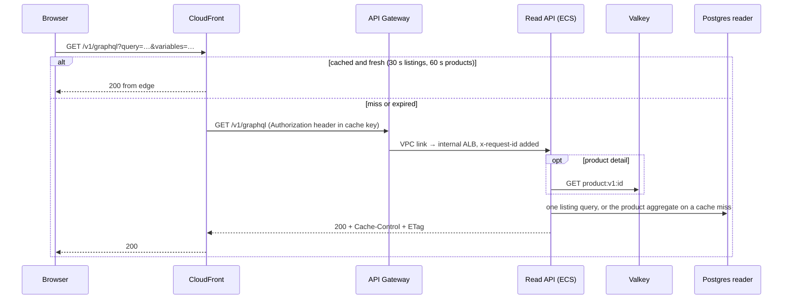
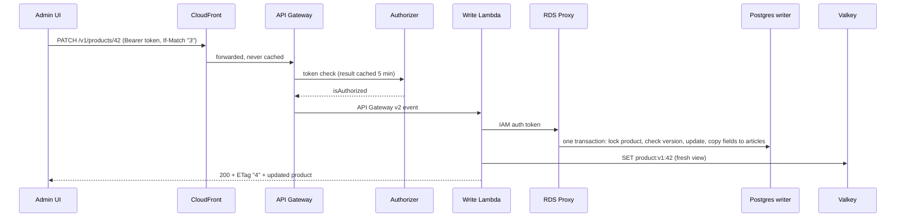
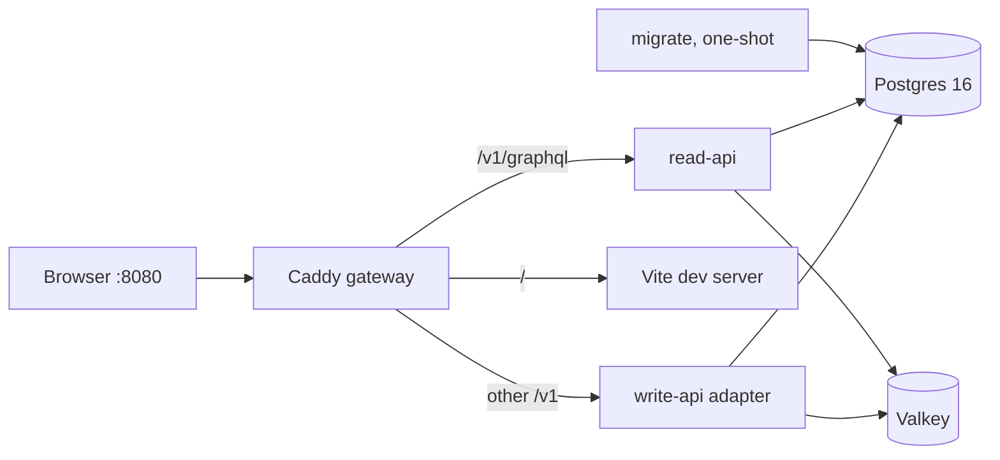
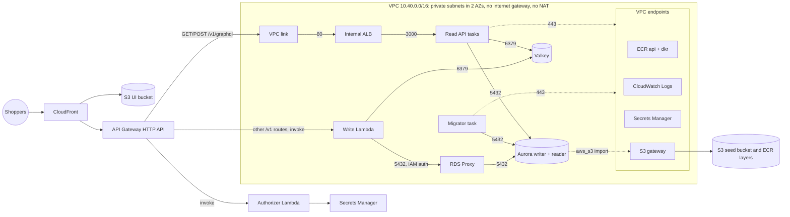

# Architecture

## Components

| Component                | Runs on                                   | Code                                       | Talks to                                       |
| ------------------------ | ----------------------------------------- | ------------------------------------------ | ---------------------------------------------- |
| Storefront and admin UI  | S3 + CloudFront                           | `app/web`                                  | `/v1/graphql`, `/v1/*`                         |
| Read API (GraphQL)       | ECS: Fargate in prod, one EC2 host in dev | `app/services/read-api`                    | Postgres reader, Valkey                        |
| Write API (REST)         | Lambda, in the VPC                        | `app/services/write-api`                   | RDS Proxy (prod) or the instance (dev), Valkey |
| Authorizer               | Lambda, outside the VPC                   | `app/services/write-api/src/authorizer.ts` | Secrets Manager                                |
| Migrator and seed import | One-off ECS task                          | `app/services/migrator`                    | Postgres writer, S3 via `aws_s3`               |
| Kill switch (dev)        | Lambda                                    | `app/services/kill-switch`                 | API Gateway, Lambda, ECS, Auto Scaling, RDS    |
| Shared code              |                                           | `app/packages/domain`, `app/packages/db`   |                                                |

## Read request

## Write request

## Local stack

`docker compose up` in `app/` runs the same services. A Caddy gateway reproduces the API
Gateway routes, and the write API runs inside a Fastify adapter that mounts the Lambda
router and mimics the authorizer.

## Network (prod)

Two AZs, private subnets only, no internet gateway or NAT. ECR, CloudWatch Logs and
Secrets Manager are reached through interface endpoints, S3 through a gateway endpoint.
The ALB is internal and reachable only from the API Gateway VPC link. Security group rules
(one table in `infra/terraform/modules/network/main.tf`):

| From                   | To                                 | Port |
| ---------------------- | ---------------------------------- | ---- |
| VPC link               | ALB                                | 80   |
| ALB                    | read API                           | 3000 |
| read API, migrator     | database                           | 5432 |
| write Lambda           | RDS Proxy (prod) or database (dev) | 5432 |
| RDS Proxy              | database                           | 5432 |
| read API, write Lambda | Valkey                             | 6379 |
| VPC                    | interface endpoints                | 443  |
