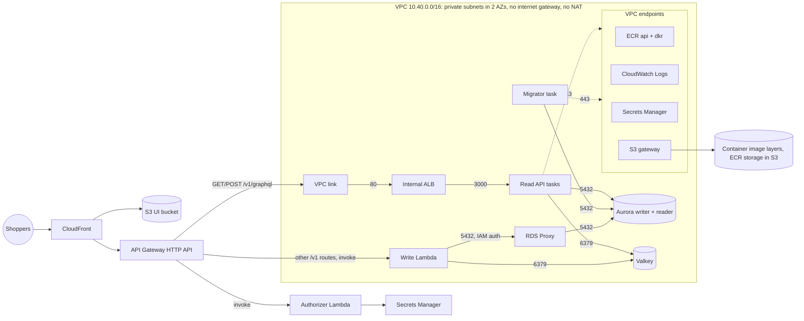
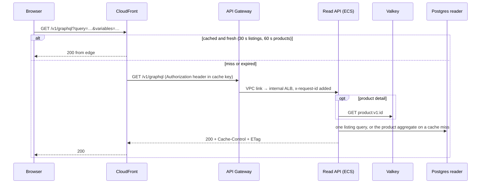
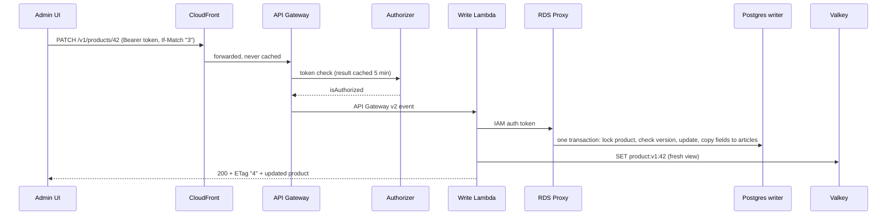
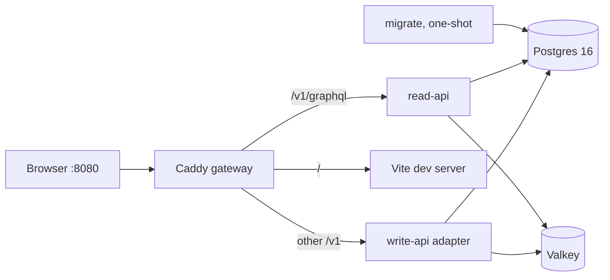

# Architecture

## Network (prod)

## Components

| Component                          | Runs on                                   | Code                                       | Talks to                                       |
| ---------------------------------- | ----------------------------------------- | ------------------------------------------ | ---------------------------------------------- |
| Storefront and admin UI            | S3 + CloudFront                           | `app/web`                                  | `/v1/graphql`, `/v1/*`                         |
| Read API (GraphQL)                 | ECS: Fargate in prod, one EC2 host in dev | `app/services/read-api`                    | Postgres reader, Valkey                        |
| Write API (REST)                   | Lambda, in the VPC                        | `app/services/write-api`                   | RDS Proxy (prod) or the instance (dev), Valkey |
| Authorizer                         | Lambda, outside the VPC                   | `app/services/write-api/src/authorizer.ts` | Secrets Manager                                |
| Migrator (seed import in dev only) | One-off ECS task                          | `app/services/migrator`                    | Postgres writer, S3 via `aws_s3` (dev)         |
| Kill switch (dev)                  | Lambda                                    | `app/services/kill-switch`                 | API Gateway, Lambda, ECS, Auto Scaling, RDS    |
| Shared code                        |                                           | `app/packages/domain`, `app/packages/db`   |                                                |

## Caching

**Most reads never reach the backend.** CloudFront serves cacheable GraphQL GETs at the
edge, so the read API and database are sized for cache misses, not for the full 2k rps.

| Layer           | What it holds                      | Lifetime                                                                             | Kept fresh by                          | Dev | Prod |
| --------------- | ---------------------------------- | ------------------------------------------------------------------------------------ | -------------------------------------- | --- | ---- |
| Browser         | GraphQL GET responses              | `max-age` per root field                                                             | ETag revalidation (304)                | yes | yes  |
| CloudFront      | GraphQL GET responses, UI assets   | listings 30 s, products 60 s, plus 10 s `stale-while-revalidate` | expiry only, no invalidation per write | yes | yes  |
| Read API memory | Categories, brands, size charts    | 5 min per task                                                                       | expiry                                 | yes | yes  |
| Valkey          | Product views by id (not listings) | 5 min                                                                                | write-through; tombstone on delete     | no  | yes  |
| Postgres reader | Source for every miss              |                                                                                      |                                        |     |      |

Measured and estimated:

- **CloudFront, measured:** 95.2% of 56,824 requests in the dev load test never reached
  the origin ([benchmarks](benchmarks.md#dev-on-aws)). One client location and a small
  product pool flatter this; capacity planning assumes 80%.
- **Valkey, estimated:** a hit costs 0.1 ms of database CPU instead of 3.5 ms, which is
  about 20% of database load at a 70% hit rate, because listings dominate and are not in
  Valkey. Not deployed in dev, so not yet measured in AWS.
- Why each layer exists and how writes interact with it:
  [ADR 0006](adr/0006-caching-strategy.md).

## Read request

## Write request

## Local stack

`docker compose up` in `app/` runs the same services. A Caddy gateway reproduces the API
Gateway routes, and the write API runs inside a Fastify adapter that mounts the Lambda
router and mimics the authorizer.

