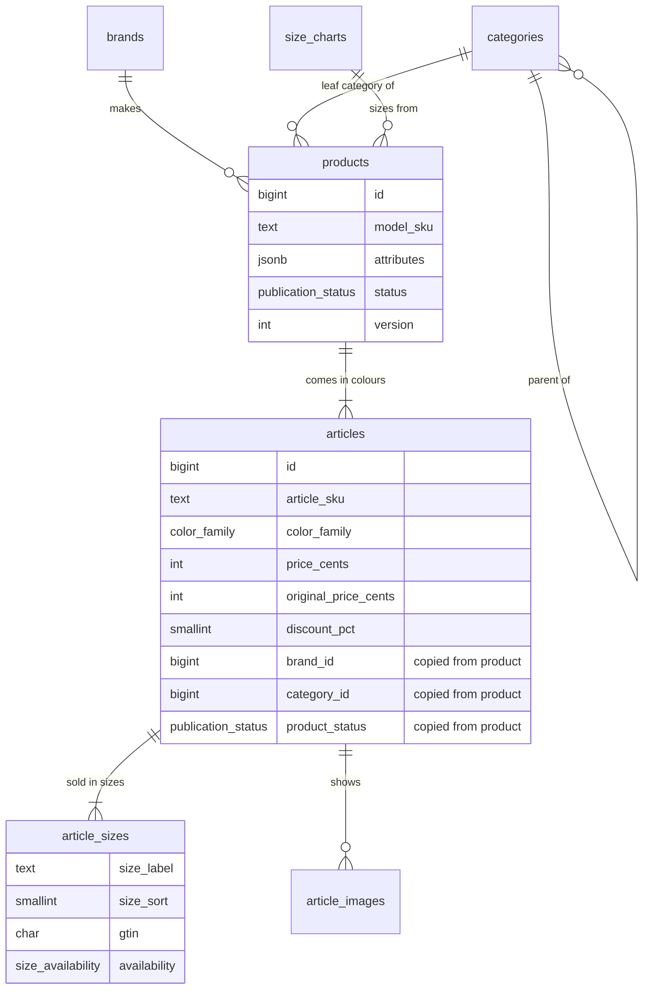

# Data model

A **product** is a style ("Relaxed fit denim jacket"). Each **article** is one colour of it,
with its own price, sale and images. Articles are the unit a shopper sees as a tile, so
filtering, sorting and pricing all happen on them. **Sizes** are the purchasable SKUs,
ordered by the size chart (S < M < L), each with a GTIN and availability.

Product fields that listings filter on (brand, category, target group, status) are copied
onto articles in the same transaction as every product write, so one index on `articles`
serves each listing. `products.version` counts changes to the whole product, its articles
and sizes, and is the value writes check with `If-Match`
([ADR 0003](adr/0003-product-article-size-model.md)).

Categories are an `ltree` tree (`women.clothing.dresses.maxi`); a parent category filter
expands to its leaf categories. Prices are integer cents. Category-specific attributes are
JSONB and deliberately not indexed: filtering on them is the point to add a search engine
([ADR 0002](adr/0002-postgres-aurora-as-primary-store.md)).

The schema is in `app/packages/db/migrations/`.

## Indexes

All listing indexes on `articles` are partial on "not deleted, article active, product
active", so they contain only rows a shopper can see.

| Index                                                                                  | Serves                                                                 |
| -------------------------------------------------------------------------------------- | ---------------------------------------------------------------------- |
| `(category_id, popularity_score DESC, id DESC)`                                        | default listing of a leaf category                                     |
| `(category_id, price_cents, id)`                                                       | category + price range, price sorts (scanned backwards for descending) |
| `(category_id, released_at DESC, id DESC)`                                             | "new in" within a category                                             |
| `(popularity_score DESC, id DESC)`, `(price_cents, id)`, `(released_at DESC, id DESC)` | listings without a category, and parent categories                     |
| `(discount_pct DESC, id DESC) WHERE is_on_sale`                                        | "biggest discount"                                                     |
| `(brand_id, category_id)`                                                              | brand filters                                                          |
| `(product_id)`, `UNIQUE (article_sku)`                                                 | product detail, SKU lookup                                             |
| `article_sizes (article_id, size_label)` unique                                        | sizes of an article                                                    |
| `article_sizes (size_label, article_id) WHERE availability <> 'out_of_stock'`          | size filter                                                            |
| `categories USING gist (path)`                                                         | descendant lookup                                                      |

Every sort index ends in `id` in the same direction, so the keyset condition
`(sort_key, id) > (…)` is one index range. Real plans for each listing, all around 1 ms on
the full seed: [query plans](query-plans.md).
